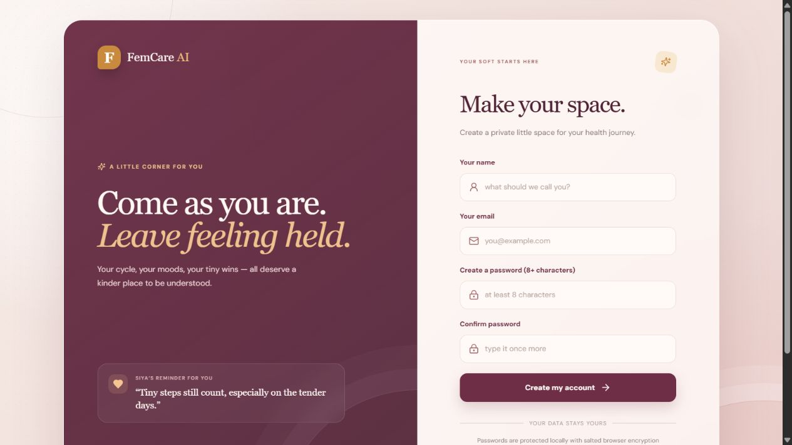
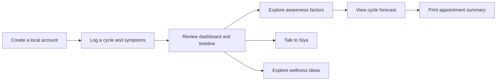
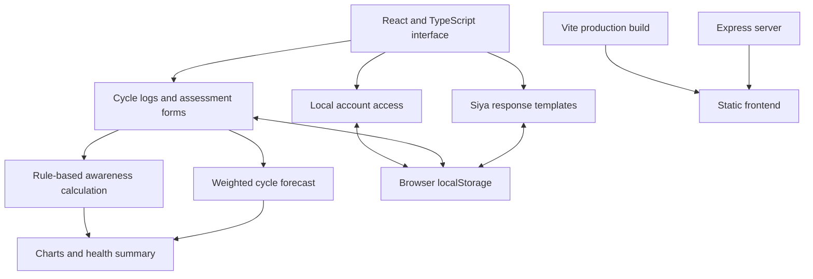
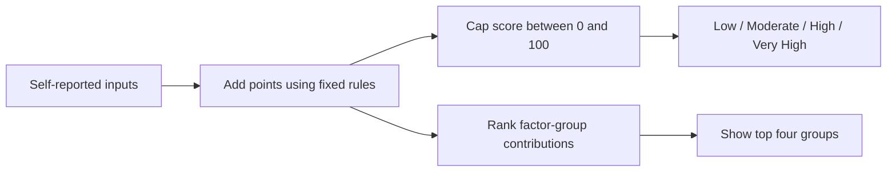

# FemCare AI

### Your health, understood.

FemCare AI brings cycle tracking, symptom check-ins, and health-pattern awareness into one personal workspace. It helps users keep a clearer record of how they feel, explore their cycle history, and prepare a useful summary for a healthcare appointment.

[Explore the live app](https://fem-care-ai-dun.vercel.app/) · [Getting started](#getting-started) · [How it works](#how-it-works)



> FemCare AI is an educational prototype. Its scores and forecasts are illustrative, have not been clinically validated, and cannot diagnose or rule out PCOS.

## What you can do

| Feature | What it offers |
| --- | --- |
| Personal workspace | Create a local account and return to records saved in the same browser. |
| Cycle and symptom logging | Record cycle length, date, symptoms, mood, sleep, exercise, and flow. |
| Health timeline | Review previous check-ins and their details. |
| PCOS awareness | Explore a rule-based score and its main contributing input groups. |
| Cycle forecasting | Estimate the next cycle length from up to six recent entries. |
| Talk to Siya | Use a contextual companion with predefined responses for common topics. |
| Nutrition and mood | Browse wellness suggestions, meal ideas, and movement options. |
| Appointment summary | Print logged patterns and questions to discuss with a clinician. |

The interface includes responsive navigation, charts, a dark-mode toggle, and an India-time greeting and date display.

## A typical journey



Start with a cycle check-in. The app saves it to the account's timeline and uses selected fields to update the awareness inputs. Users can then review a forecast, adjust their assessment, or open their health summary.

**“Share with doctor” opens the browser's print dialog.** Users can print or choose Save as PDF where supported; the app does not send a report to a doctor.

## How it works

### Application architecture



The main features run in the browser. The included Express server serves the built frontend and provides a fallback for client-side routes. It does not implement a health-data API, authentication service, or model inference endpoint.

### Awareness score

[`personalization.ts`](client/src/lib/personalization.ts) calculates the score using explicit rules for cycle regularity, physical symptoms, sleep and stress, diet and movement, family history, and optional lab inputs.



The score is a bounded point total, not a calibrated probability of PCOS, although the interface displays it as a percentage. Optional positive lab values currently add fixed points without clinical threshold interpretation. Pattern labels are heuristic UI summaries rather than medically established diagnoses.

### Cycle forecast

The forecast uses up to six entries in logging order, with increasing weight for newer entries:

```text
Estimated cycle length = round(sum(cycle length × weight) / sum(weights))
Weights = 1, 2, ..., number of available entries
```

With no entries, it uses a 28-day fallback. It flags variation when the standard deviation around the rounded forecast exceeds 3.5 days. This is a weighted estimate, not a trained forecasting model. Entries are not automatically sorted by their recorded dates before calculation.

### Siya companion

Siya uses keyword matching and predefined responses, with context such as the user's name and recent check-in. Chat history is stored in the browser. A companion prompt template exists in the repository, but the current chat does not call an external language model API.

## Data and privacy

Accounts, session identifiers, logs, assessment inputs, risk summaries, chat history, and movement preferences are stored in browser `localStorage`. Health entries use keys scoped to the local account ID.

| Item | Current behavior |
| --- | --- |
| Accounts | Local to the device/browser; no cloud account service. |
| Password checks | Salted PBKDF2-SHA-256 verifier with 120,000 iterations, calculated using Web Crypto. |
| Health logs and chat | Persist across refreshes; not encrypted by the application. |
| Cross-device access | Not implemented. |
| Logout | Removes session keys; saved accounts and health records remain. |
| Clearing site data | Removes saved records; no server backup. |

The password verifier is a hash-derived value, not encryption of health data. Local account access is a prototype convenience, not production-grade protection for sensitive records. Use fictional information when exploring the public demo.

The development configuration includes browser-console, network, and session-event logging hooks that write submitted payloads to `.manus-logs/`. The normal production build omits the injected debug collector script. Review these development hooks before testing with sensitive information.

## Technology stack

| Area | Tools |
| --- | --- |
| Frontend | React 19, TypeScript 5.6, Vite 7 |
| Styling and components | Tailwind CSS 4, Radix UI, Lucide React |
| Charts | Recharts |
| Local password verification | Browser Web Crypto API |
| Production server | Express 4, Node.js, esbuild |
| Development | pnpm, Prettier, TypeScript checks |

Other dependencies include form, animation, calendar, routing, and testing libraries. Not every installed package is used by the active screens.

## Project structure

```text
FemCare-AI/
├── client/
│   ├── index.html
│   └── src/
│       ├── App.tsx                 # Local account access and app entry
│       ├── main.tsx                # React bootstrap
│       ├── index.css               # Application styling
│       ├── pages/
│       │   ├── Login.tsx           # Local account creation and sign-in
│       │   ├── Home.tsx            # Dashboard and feature screens
│       │   └── NotFound.tsx
│       ├── lib/
│       │   ├── auth.ts             # Local accounts and password verifier
│       │   ├── personalization.ts  # Awareness rules and companion prompt
│       │   └── utils.ts
│       ├── components/            # Shared interface components
│       ├── contexts/
│       └── hooks/
├── server/index.ts                # Static production server
├── shared/                        # Shared constants
├── patches/                       # Patched dependency files
├── package.json
├── pnpm-lock.yaml
├── vite.config.ts
└── README.md
```

## Getting started

Use Node.js compatible with Vite 7 and **pnpm 10.4.1**, as declared in `package.json`. The default branch is `finalized-femcare-ai`.

```bash
git clone --branch finalized-femcare-ai https://github.com/trivedivaishnavi/FemCare-AI.git
cd FemCare-AI
pnpm install --frozen-lockfile
pnpm dev
```

Open the address printed in the terminal. Development starts on port 3000 and can select another available port. Use localhost or HTTPS for the Web Crypto account functions.

The core browser features do not require an external AI key or database connection. Optional storage-proxy infrastructure in the development configuration is separate from the local health-tracking workflow.

### Useful commands

| Command | Purpose |
| --- | --- |
| `pnpm dev` | Start the Vite development server. |
| `pnpm check` | Run TypeScript checks. |
| `pnpm build` | Build the frontend and bundle the Express server. |
| `pnpm preview` | Preview the built frontend locally. |
| `pnpm start` | Start the production Express server on POSIX shells. |
| `pnpm format` | Format source files with Prettier. |

For a production start in Windows PowerShell, run `pnpm build` first, then:

```powershell
$env:NODE_ENV = "production"
node dist/index.js
```

Frontend output is `dist/public/`; the server bundle is `dist/index.js`. The server uses `PORT`, defaulting to 3000.

## Understanding the model comparison

The interface contains a fixed demonstration table:

| Metric | Logistic Regression | Random Forest |
| --- | ---: | ---: |
| Accuracy | 84% | 89% |
| Precision | 81% | 87% |
| Recall | 78% | 86% |
| F1 score | 79% | 86% |
| ROC AUC | 0.88 | 0.93 |

These values are hardcoded in `Home.tsx`. The inspected branch has no reproducible training pipeline, persisted classifier, or the previously described 420-record generated dataset. The live score comes from `calculateRisk`. Treat this table as demonstration content, not measured or clinical performance.

## Current boundaries

- Some trends, phase cards, and narrative text are fixed examples or fallback values rather than being fully derived from user logs.
- Forecasts depend on entry order. Backdated entries can affect the estimate.
- Awareness rules and pattern labels need clinical review; no clinical validation is included.
- The companion follows predefined branches rather than open-ended model reasoning.
- Browser storage provides persistence on one device without cloud backup or encrypted health records.
- Vitest is listed as a dependency, but this branch has no dedicated test script or automated test suite.

This README was checked against source files and the live welcome screen. A clean installation, production build, and full account workflow were not executed during this update.

## Where the project can go next

Useful next steps include replacing example charts with logged data, validating and sorting entries before forecasting, and testing scoring and persistence. A reproducible research workflow could compare trained models with simple baselines, keeping evaluation separate from the educational UI. Real health-data use would also need appropriate authentication, storage protections, and professional review.

## License

`package.json` declares MIT. A standalone license file is not included in the inspected branch.
